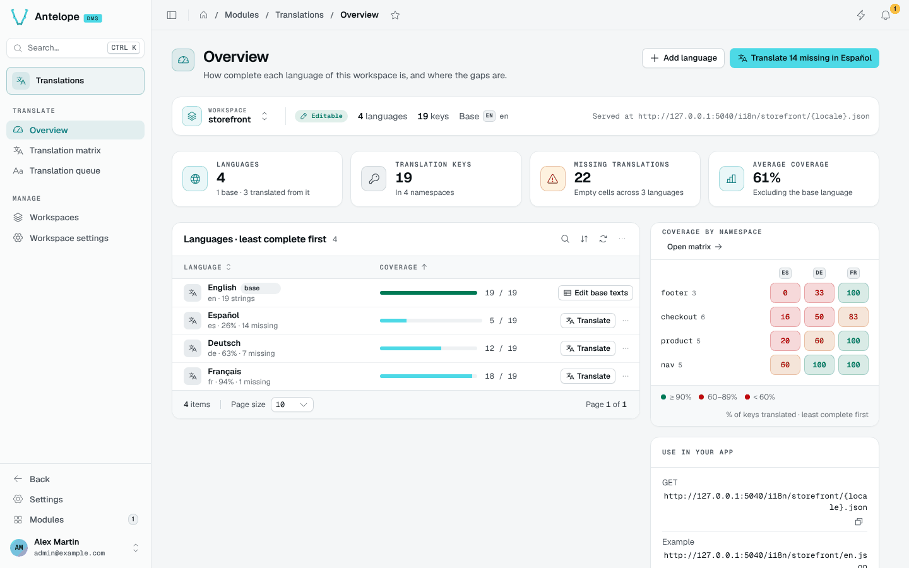

<div align="center">

# @antelopejs/dms-lang

<a href="https://www.npmjs.com/package/@antelopejs/dms-lang"></a>
<a href="./LICENSE"></a>
<a href="https://discord.gg/sjK28QHrA7"></a>
<a href="https://dms.antelopejs.com/docs/modules/lang"></a>

Language and translation management for the AntelopeJS DMS.

</div>



## What it does

- Reads every locale file the dashboard loads and shows how complete each language is, with a namespace × language heatmap.
- Edits every key side by side in a translation matrix, with placeholder checks, filters and CSV export.
- Walks one language key by key in a translation queue, with the base text and the other languages for context.
- Hosts translation workspaces for your other apps and serves them as public JSON at `/i18n/<workspace>/<locale>.json`.

## Install

Run the AntelopeJS CLI from the root of a project that already loads `@antelopejs/dms`:

```bash
ajs project modules add @antelopejs/dms-lang
```

## Quick start

The module starts read-only. Allow writes on the process that edits translations:

```ts fragment
// antelope.config.ts
"dms-lang": {
  source: { type: "package", package: "@antelopejs/dms-lang", version: "^0.2.0" },
  config: {
    editable: true,
  },
},
```

Restart the backend, then the frontend, and open **Modules › Translations** (`/modules/lang/overview`). To edit your own frontend module's locale files, register it with `options: { dmsI18nAppLayer: true }`: see [Installation](https://dms.antelopejs.com/docs/modules/lang/installation).

## Compatibility

<!-- antelopejs-docs-compat:start -->

| Package                          | Supported                                                      | Tested with                                                    |
| -------------------------------- | -------------------------------------------------------------- | -------------------------------------------------------------- |
| `@antelopejs/interface-api`      | `file:.campaign/tgz/antelopejs-interface-api-f2a99b5.tgz`      | `file:.campaign/tgz/antelopejs-interface-api-f2a99b5.tgz`      |
| `@antelopejs/interface-api-util` | `file:.campaign/tgz/antelopejs-interface-api-util-919c623.tgz` | `file:.campaign/tgz/antelopejs-interface-api-util-919c623.tgz` |
| `@antelopejs/interface-core`     | `>=0.2.4 <1.0.0`                                               | `0.2.6`                                                        |
| `@antelopejs/interface-dms`      | `file:.campaign/tgz/antelopejs-interface-dms-0cfaaa3.tgz`      | `file:.campaign/tgz/antelopejs-interface-dms-0cfaaa3.tgz`      |

<!-- antelopejs-docs-compat:end -->

The module also needs a DMS backend in a release that implements the `@antelopejs/interface-dms` range above, and the `@antelopejs/dms-frontend` renderer in the range its frontend module declares in `engines["@antelopejs/dms-frontend"]` of `frontend-vue/package.json`; the `ajs dms` CLI refuses to build it with a renderer outside that range.

## Documentation

- [Introduction](https://dms.antelopejs.com/docs/modules/lang/introduction)
- [Installation](https://dms.antelopejs.com/docs/modules/lang/installation)
- [Configuration](https://dms.antelopejs.com/docs/modules/lang/configuration)
- [Usage](https://dms.antelopejs.com/docs/modules/lang/usage/overview)
- [Extending](https://dms.antelopejs.com/docs/modules/lang/extending)
- [FAQ](https://dms.antelopejs.com/docs/modules/lang/faq)

The canonical guide lives in [`docs/`](./docs), including the [supported extension boundary](./docs/5.extending.md#supported-extension-boundary). There is no separate DMS Lang interface package. The package also ships the `dms-lang` Claude Code skill in [`skills/`](./skills), declared under `antelopeJs.skills`.

## Contributing

Read [CONTRIBUTING.md](./CONTRIBUTING.md) before opening a pull request. The playground connects to MongoDB at `mongodb://localhost:27017`; set `MONGO_URL` to use another instance.

```bash
pnpm install
pnpm dev            # playground backend
pnpm frontend:dev   # dashboard, in a second terminal
pnpm lint
pnpm typecheck
pnpm test
```

<details>
<summary>Repository notes</summary>

- The backend registers `frontend-vue/dms.frontend.ts` through `AddFrontendModule` with the Vue 3 renderer, under the `DmsLang` component prefix: every component of `app/components` and `app/build/components` is registered under it, and the backend pages name them (`CustomComponent("DmsLangTranslationMatrix")`). `dms.frontend.build.ts` auto-imports `app/composables`, `app/utils` and `app/types`; `app/build/` is private and imported by path.
- The pages read their data with the DMS's `useApiData`, which the server render hands to the browser with the page. The public language files (`/i18n/**`) are declared to the frontend server as a backend prefix without a session (`backendProxies`).
- The module compiles against the published `@antelopejs/interface-dms`; `@antelopejs/dms` and `@antelopejs/dms-frontend` are development dependencies, needed by the tests and the playground.
- `pnpm test:unit` checks locale discovery, the coverage, placeholder and message helpers, and renders the workspace composables on a server (`tests/frontend-runtime.mjs`). The backend tests (`src/test`) run with `pnpm test` only, since an interface refuses to load outside the AntelopeJS runtime. `pnpm test:frontend` compiles the module against the published DMS frontend with the renderer's source verifier.

</details>

## License

[Apache-2.0](./LICENSE)
