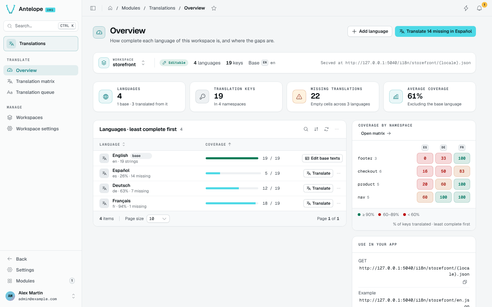

`@antelopejs/dms-lang` adds a translation workspace to the AntelopeJS DMS. It reads every locale file the dashboard loads, shows how complete each language is, and lets your team fill the gaps in a matrix or one key at a time. It also hosts translation files for your other apps, such as a website or a mobile app, and serves them as public JSON.

## Publish one translated message

Take a team that publishes one message for its shop. After [installation](/docs/modules/lang/installation), with editing turned on, the team creates a workspace named `storefront` with `en` as its base language. It adds `fr`, then the key `checkout.pay` with the English text `Pay now`. Someone enters `Payer maintenant` in the French cell and saves.

The shop's app can now read `/i18n/storefront/fr.json` from the configured public origin. For that key, the response contains `{"checkout":{"pay":"Payer maintenant"}}`. [Load a workspace in another app](/docs/modules/lang/extending#load-a-workspace-in-another-app) shows the request and explains the fallback for missing translations.

Anyone can read these files. They are for interface text, never for secrets or private customer content. A Lang workspace is a set of translation files. It is not a SaaS customer workspace.

## What it brings

::card-group
  ::card{title="Coverage at a glance" icon="i-lucide-gauge"}
  KPIs, languages ranked least complete first and a namespace × language heatmap show where the gaps are.
  ::

  ::card{title="Translation matrix" icon="i-lucide-table"}
  Every key side by side across languages, with inline editing, placeholder checks, filters and CSV export.
  ::

  ::card{title="Translation queue" icon="i-lucide-list-checks"}
  One language, one key at a time, with the base text, the other languages for context and keyboard shortcuts.
  ::

  ::card{title="Workspaces for your apps" icon="i-lucide-layers"}
  Separate sets of translation files for other apps, served publicly at `/i18n/<workspace>/<locale>.json`.
  ::
::

## Three kinds of workspace

A workspace is one set of translation files. Every page of the module works on the workspace named in its scope bar. The page keeps that workspace in the URL (`?workspace=`), so a link or a refresh opens the same one.

| Workspace | Id | Editable | Where the files live |
| --- | --- | --- | --- |
| **Project files** | `default` | Yes, when `editable` is on | The `i18n/locales/<name>-<xx-XX>.json` files of your project's frontend module |
| **Installed modules** | `modules` | No, override a key to change it | The locale files shipped by the DMS and its modules |
| **Workspaces you create** | Any name you choose | Yes, when `editable` is on | The module's `i18n-workspaces/<name>` folder, served publicly |

## Where it lives in the dashboard

The module registers under `/modules/lang` with two sidebar groups:

- **Translate** holds [Overview](/docs/modules/lang/usage/overview), [Translation matrix](/docs/modules/lang/usage/translation-matrix) and [Translation queue](/docs/modules/lang/usage/translation-queue).
- **Manage** holds [Workspaces](/docs/modules/lang/usage/workspaces) and [Workspace settings](/docs/modules/lang/usage/workspace-settings).

The command palette (`Ctrl K`) also offers **Translate missing keys**, **Add a translation key**, **Add a language** and **New translation workspace**.

::note
Like every DMS module, the Lang pages are reserved to the platform owner. Each write route also checks the permission of the action it belongs to, so the module is ready if module access opens to roles.
::

## Next steps

::card-group
  ::card{title="Installation" icon="i-lucide-download" to="/docs/modules/lang/installation"}
  Add the module to a DMS project.
  ::

  ::card{title="Configuration" icon="i-lucide-settings" to="/docs/modules/lang/configuration"}
  Turn on editing and mark your app's translations as writable.
  ::
::
