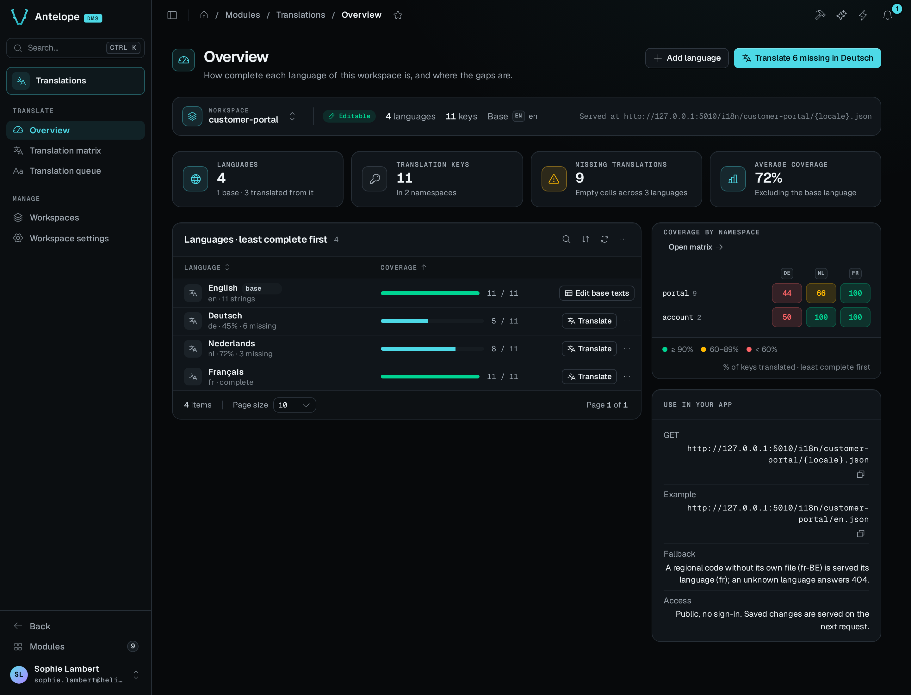

The Overview shows how complete each language of the current workspace is. It is under **Translate › Overview** in the navigation.

## What the page shows

- **Scope bar.** The current workspace, whether it is **Editable** or **Read-only**, its language and key counts, and its base language. For a workspace you created, it also shows the public URL the workspace is served at. Every page of the module has the scope bar, and its menu switches to another workspace.
- **Workspace figures.** Four cards: **Languages**, **Translation keys**, **Missing translations** (the empty cells across the languages other than the base) and **Average coverage**, which leaves out the base language.
- **Languages · least complete first.** One row per language, with a coverage bar. The base language is pinned on top. On another language, **Translate** opens the [translation queue](/docs/modules/lang/usage/translation-queue) of that language. On the base language, **Edit base texts** opens the [translation matrix](/docs/modules/lang/usage/translation-matrix). The row menu of a language other than the base makes that language the base or removes it.
- **Coverage by namespace.** A heatmap of the percentage of keys translated, per namespace and per language. A namespace is the first segment of a key, so `checkout` is the namespace of `checkout.total`. A cell is green at 90% and above, amber from 60 to 89%, and red below 60%. The heatmap shows at most 6 namespaces and 6 languages. When it hides some, **See all in the matrix** opens the matrix. A cell opens the matrix on its namespace, filtered on the keys missing in its language when there are any.
- **Use in your app.** Where the keys live and how they load. For a workspace you created, it gives the public `GET` URL, an example URL for the base language, the fallback rule and the access note.

## Header actions

**Add language** opens the language picker. It shows only on a workspace you created, on a server where editing is turned on.

When a language has missing keys, a second action names the least complete one, for example **Translate 14 missing in Español**. It opens the translation matrix filtered on the keys missing in that language.

::tip
The page URL keeps the workspace in its `?workspace=` query, so a shared link opens the same workspace.
::
