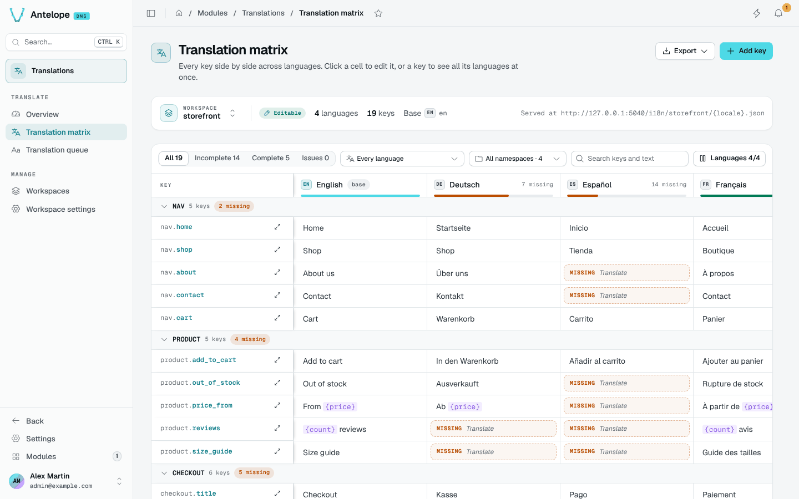
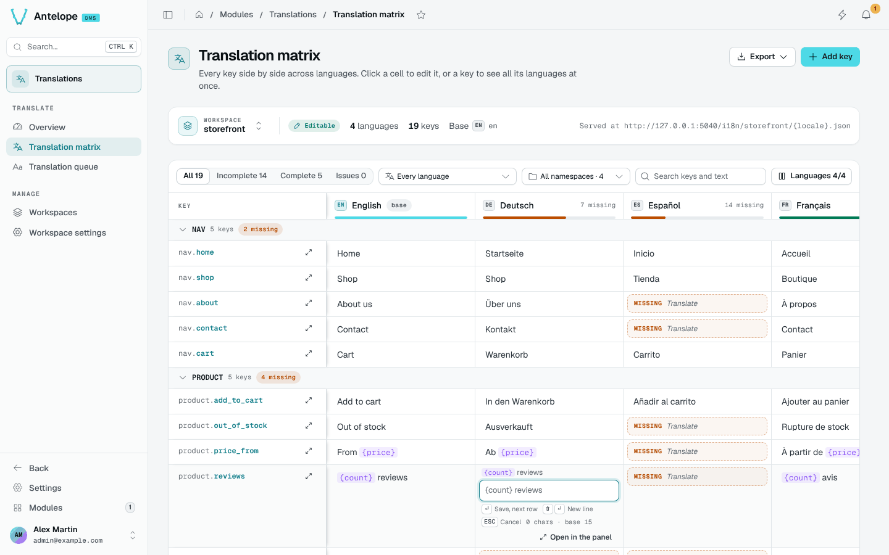
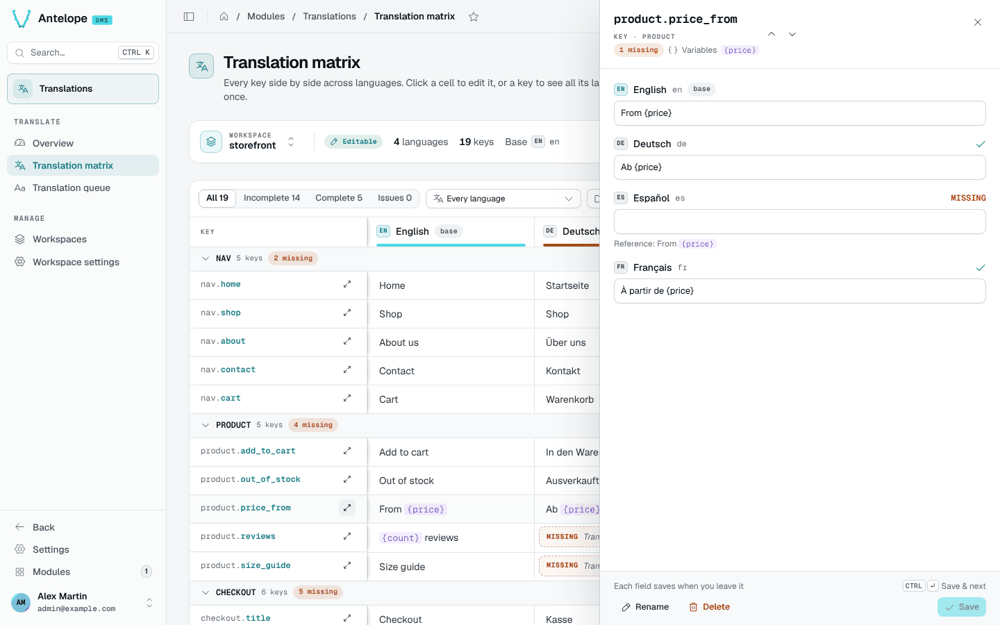

# Translation matrix

The matrix shows every key of the workspace as a row and every language as a column. Open it from **Translate › Translation matrix**. Its sidebar badge counts the missing translations of the project files.

## Find what to translate

- **Status tabs**: All, Incomplete, Complete and Issues (cells whose placeholders differ from the base text).
- **Missing in**: keep the rows missing in one language, or in any language, whatever columns are shown.
- **Namespaces**: restrict the rows to one or more namespaces. Rows are grouped by namespace, and each group can collapse.
- **Search**: match key paths and texts.
- **Languages**: choose the columns to show. Each column header carries its missing count and a coverage bar.

The matrix draws 150 rows at a time; **Show more** loads the next ones, so large workspaces stay responsive.

## Edit a cell

Click a cell to edit it in place.

| Shortcut | Action |
| --- | --- |
| `Enter` | Save and move to the next row. |
| `Shift Enter` | Add a line break. |
| `Escape` | Cancel. |

Each cell shows its own state (saving, saved, or not saved with **Retry**), and keeps your text when a save fails.

Placeholders such as `{price}` render as tokens. A cell whose placeholders differ from the base text is flagged, in the matrix, the key panel and the queue.

## Work on one key

The expand icon next to a key opens the **key panel**. Use it to:

- Edit every language in a stacked view, with the base text as reference.
- Check placeholders and use **Insert {token}**.
- Move to the previous or next key.
- **Rename** or **Delete** the key.

**Save** writes every changed language in one request.

## Add, rename and delete keys

**Add key** asks the key path and its base text; **Add another** keeps the dialog open. Deleting a key lists the translations it removes, and the toast offers **Undo**.

## Installed modules

In the **Installed modules** workspace the matrix is read-only. Each row has an **Override** button: it switches to the project files and opens the key there, so your project redefines the text. Rows already overridden carry an **Overridden** badge.

::note
In the project files, a key an installed module already translates shows the module's text, dimmed with "From a module". It counts as translated and stays out of the missing counts.
::

## Export

**Export** downloads the workspace as CSV (the key and one column per language), generated in the browser.
