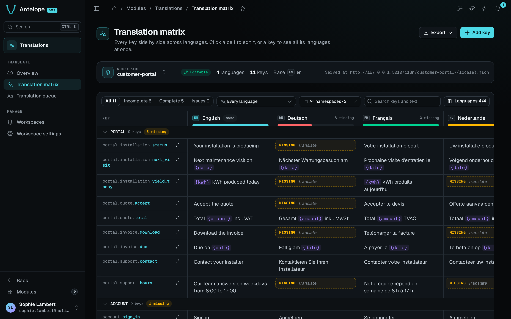
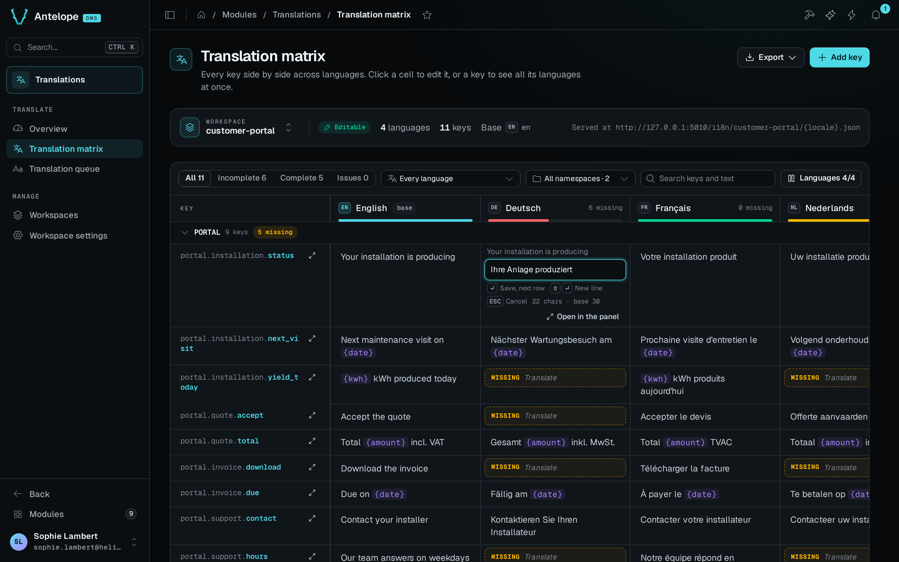
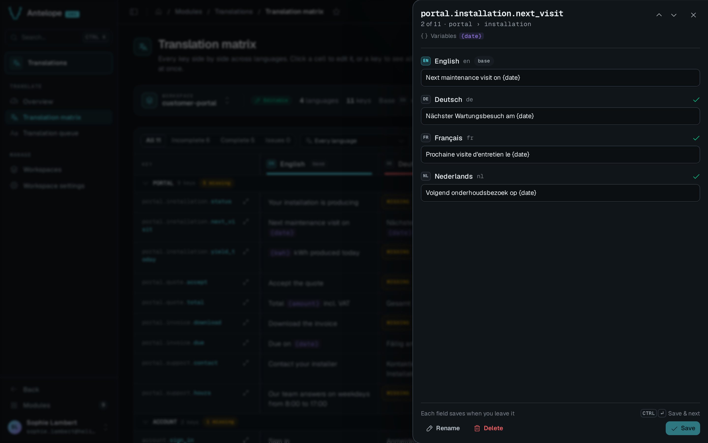
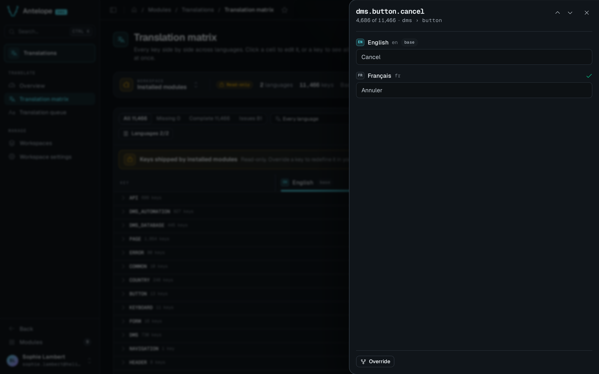
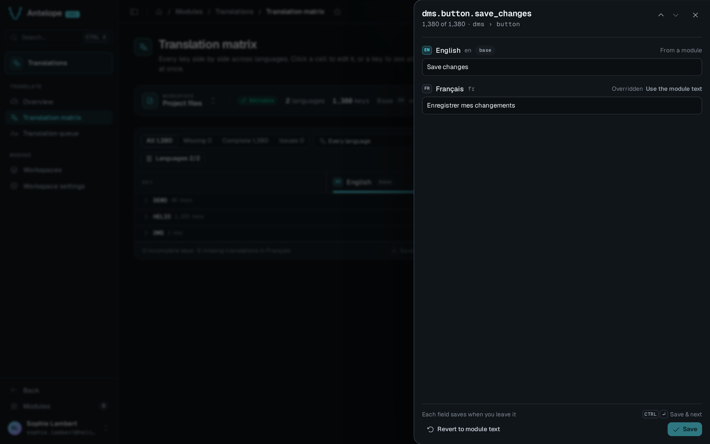

The matrix shows every key of the workspace as a row and every language as a column. It is under **Translate › Translation matrix** in the navigation. Its navigation badge counts the missing translations of the project files.

## Find what to translate

The toolbar above the matrix has these filters:

- **Status tabs.** **All**, **Missing**, **Complete** and **Issues**, each with its count. **Missing** reads **Incomplete** when the counts cover more than one language. **Issues** keeps the keys whose base text is missing or does not compile, and the keys with a translation to review. A translation needs review when it has an issue (a variable of the base text left out, a variable the base text does not have, a different number of plural forms, a syntax error, or spaces at its ends) or when the base text changed after it was translated.
- **Translate into.** The language menu offers **Every language** or one language. Picking one language switches to **Missing** and counts the keys missing in that language, whatever columns are shown.
- **Namespace.** **All namespaces**, or one namespace.
- **Search keys and text.** Matches key paths and the texts of every language.
- **Languages.** The menu that chooses the columns to show. Drag a language in it to reorder the columns. Each column header shows the language's missing count and a coverage bar.

Rows are grouped by namespace, and each group can collapse. When the workspace has more than 300 keys in more than one namespace, the groups start collapsed. The matrix draws 100 rows at a time and draws the next ones as you scroll to the end, so large workspaces stay responsive.

## Edit a cell

Click a cell to edit it in place. These keys work while you edit a cell:

| Shortcut | Action |
| --- | --- |
| `Enter` | Save the cell and edit the one below. |
| `Shift Enter` | Add a line break. |
| `Ctrl Enter` or `⌘ Enter` | Save the cell and stay on it. |
| `Tab` | Save the cell and edit the next one. `Shift Tab` edits the previous one. |
| `Ctrl Shift Enter` or `⌘ Shift Enter` | Open the key in the key panel, with the text you typed. |
| `Escape` | Cancel the edit. |

Outside a text field, with no dialog open, `N` edits the next missing translation and `Shift N` edits the previous one.

A cell also saves when it loses focus. Each cell shows its own state: saving, saved, or **Not saved** with **Retry**. A cell keeps your text when a save fails.

Placeholders such as `{price}` render as tokens. The matrix, the key panel and the queue all flag a translation whose placeholders differ from the base text. A cell that leaves out a variable of the base text offers an **Insert {token}** button for it.

## Work on one key

The expand icon next to a key opens the **key panel**. In the key panel you can:

- Edit every language in a stacked view, with the base text as reference.
- Check the **Variables** of the base text and use **Insert {token}**.
- Move to the previous or next key with the arrows, or with `J` (next) and `K` (previous) when you are not typing in a field. The header shows the key on two lines at most, cut with an ellipsis. Under it, on one line, are the key's place among the keys the matrix lists (`12 of 1,338`) and the namespaces above it.
- Press `Ctrl Enter` or `⌘ Enter` in a field to save the texts and open the next key.
- **Rename** or **Delete** the key. On a key that overrides a module text, **Revert to module text** takes the place of **Delete**, and **Rename** is hidden.

**Save** writes every changed language in one request.

The key panel is a DMS drawer docked on the right. The open key is in the URL (`?key=`), so a link or a reload opens it again, and the browser's **Back** button closes it. Closing it with its X, `Escape` or a click outside saves the changed languages first. When one of them cannot be saved, the panel stays open on it. The reason can be a placeholder error, a conflict or a failed request. The panel asks no confirmation, and a field also saves as soon as you leave it. The one exception is clearing the base text, which asks first. Drag the left edge of the panel to resize it. It opens again at that width on this device. Closing it leaves the matrix as it was, with its groups still open. Its footer stays on the bottom edge of the drawer, however few or many languages the key has. The footer holds the save state, **Save**, **Rename** and **Delete**.

## Add, rename and delete keys

**Add key** asks for the key path and its texts. It shows three languages, the base language first. **Show {n} more languages** opens the others. The key needs a text in at least one language. **Add another** keeps the dialog open for the next key. Deleting a key lists the translations it removes, and the toast that follows offers **Undo**.

## Installed modules

In the **Installed modules** workspace the matrix is read-only. When editing is turned on, hovering a row shows an **Override** button. It switches to the project files and opens the key there, so your project redefines the text. An overridden row carries an **Overridden** badge, and clicking it opens the override in the project files.

The key panel of `dms.button.cancel` shows its module values and the **Override** action.

After **Override** on `dms.button.save_changes`, that key opens in **Project files**. In the capture below, the French value is saved as `Enregistrer mes changements`, while English still comes from the module.

The project replaces the French value without modifying the installed module. **Override** opens the editor. Saving a value there creates the project override.

::note
In the project files, a key an installed module already translates shows the module's text, dimmed with **From a module**. It counts as translated and stays out of the missing counts.
::

## Export

**Export** downloads a CSV file, generated in the browser. Its menu has two choices:

- **This view** exports the keys and the language columns the matrix shows, to `<workspace>-view-<codes>.csv`.
- **Everything** exports every key and every language, to `<workspace>-all.csv`.

The file has a `key` column, then one column per language with the base language first.
