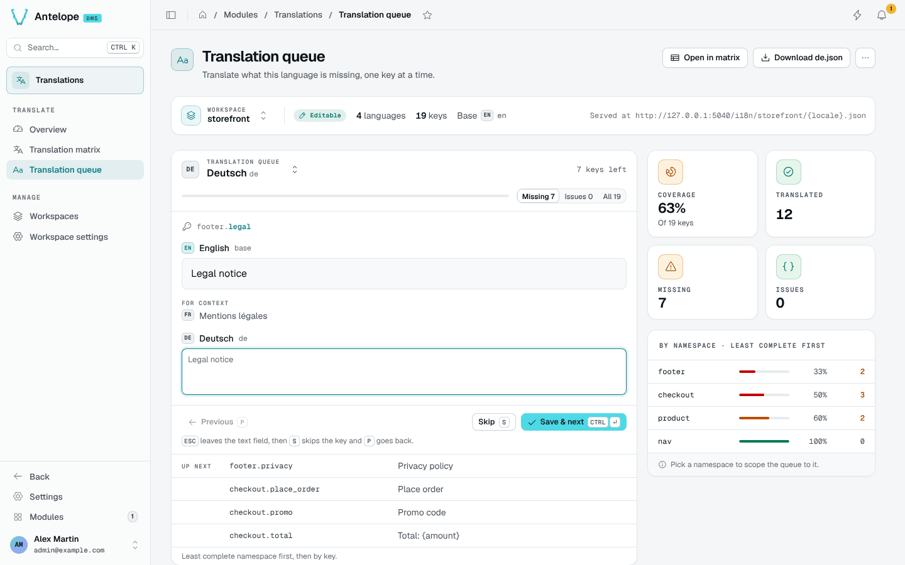

# Translation queue

The queue is the fastest way to finish a language. It shows one key at a time, least complete namespace first. Open it from **Translate › Translation queue**, from **Translate** on a language row, or with `?locale=<code>` in the URL.

## Translate a key

For each key, the queue shows the base text, the other languages for context and a text field for the language you translate.

| Shortcut | Action |
| --- | --- |
| `Ctrl Enter` / `⌘ Enter` | Save and move to the next key |
| `Escape`, then `S` | Skip the key |
| `Escape`, then `P` | Go back to the previous key |

The **Missing**, **Issues** and **All** tabs choose which keys the queue walks through. **Up next** lists the following keys.

## Side panel

The stat cards give the language's coverage, translated keys, missing keys and placeholder issues. The **By namespace** list ranks the namespaces least complete first; pick one to scope the queue to it.

## Header actions

- **Open in matrix** opens the matrix filtered on the keys missing in this language.
- **Download `<code>.json`** downloads the language's messages.
- The overflow menu makes the language the base or removes it. Removal asks you to type the language code.
