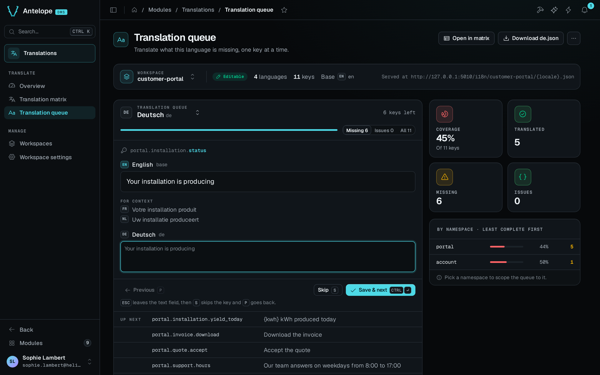

The queue shows one language one key at a time, least complete namespace first, then by key. It is under **Translate › Translation queue** in the navigation. **Translate** on a language row of the overview opens it too, and so does a URL with `?locale=<code>`. Without a language in the URL, the queue asks you to choose one.

## Translate a key

For each key, the queue shows the base text, the other languages under **For context**, and a text field for the language you translate. **Previous**, **Skip** and **Save & next** sit under the field.

| Shortcut | Action |
| --- | --- |
| `Ctrl Enter` or `⌘ Enter` | Save the text and go to the next key. |
| `Ctrl S` or `⌘ S` | Save the text and stay on the key. |
| `Escape`, then `S` | Leave the text field, then skip the key. |
| `Escape`, then `P` | Leave the text field, then go back to the previous key. |

`S` and `P` act only outside a text field, so typing never skips a key.

The **Missing**, **Issues** and **All** tabs choose which keys the queue walks through. **Missing** is the default. **Up next** lists the following keys.

## Side panel

The stat cards give the language's **Coverage**, **Translated** keys, **Missing** keys and **Issues**. The **Issues** count covers the translations to review. A translation needs review when it has an issue, such as a variable of the base text left out, or when it was translated from an older base text. The **By namespace · least complete first** list ranks the namespaces of the language. Pick one to scope the queue to it.

## Header actions

- **Open in matrix** opens the [translation matrix](/docs/modules/lang/usage/translation-matrix) filtered on the keys missing in this language, in the namespace the queue is scoped to. On the base language, it opens the matrix in that namespace with no status filter.
- **Download `<code>.json`** downloads the messages of the language.
- The overflow menu has **Make base language** and **Remove language**. When the language has translated strings, removing it asks you to type the language code and offers to download `<code>.json` first.
