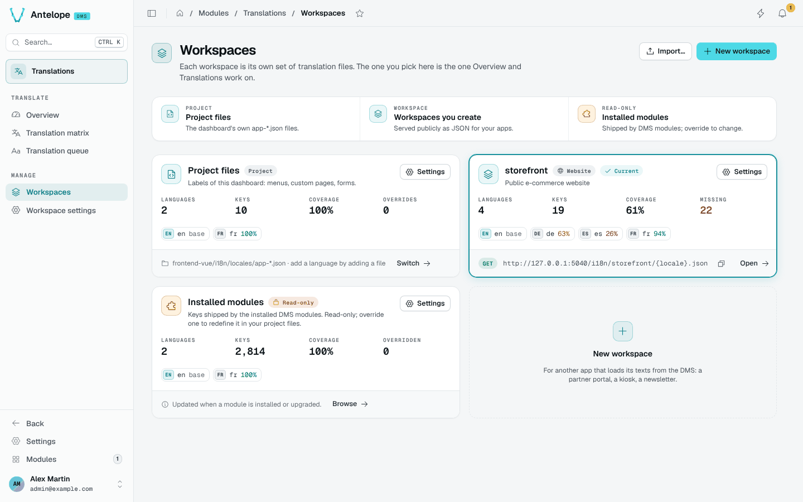
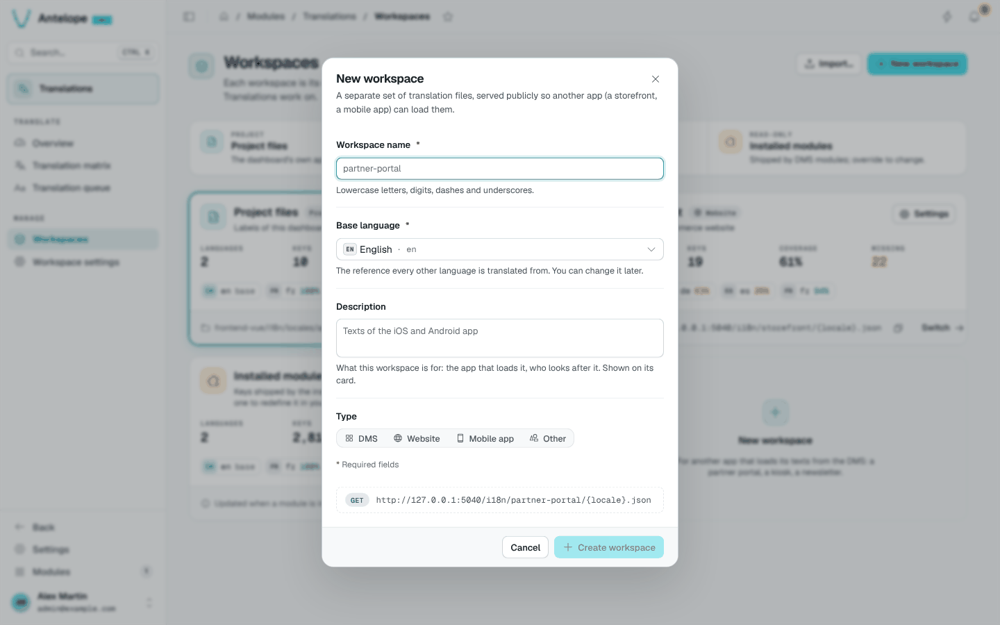
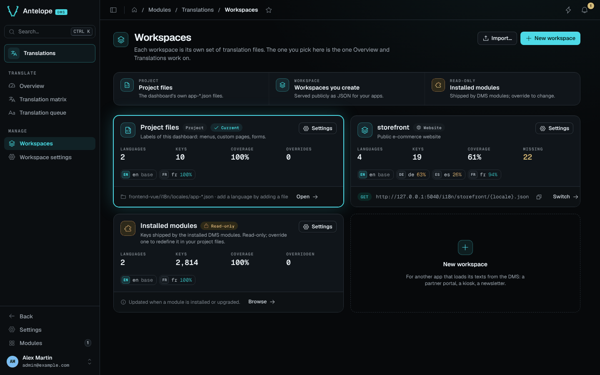

# Workspaces

The Workspaces page lists every set of translation files with its size and coverage. Open it from **Manage › Workspaces**. The workspace you pick here is the one the Translate pages work on.

## The cards

Each card shows the workspace's languages, keys, coverage and missing count (or overrides for the project files), with a chip per language.

- **Project files**: the locale files of the dashboard's own frontend module (any `<name>-<xx-XX>.json`). Add a language by adding a file.
- **Workspaces you create**: served publicly, with their `GET` URL and a copy button.
- **Installed modules**: read-only, updated when a module is installed or upgraded.

**Switch** makes a workspace current; **Settings** opens its [workspace settings](/docs/modules/lang/usage/workspace-settings).

## Create a workspace

**New workspace** asks a name (lowercase letters, digits, dashes and underscores), a base language, an optional description and a type (DMS, Website, Mobile app, Other). The dialog previews the public URL the workspace will be served at.

## Import a workspace

**Import…** creates a workspace from a backup file, such as the one **Download backup** produces in the danger zone of the workspace settings.

::tip
The page follows the dashboard theme. In dark mode it looks like this:

::
