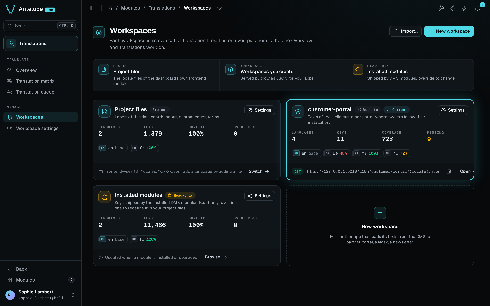
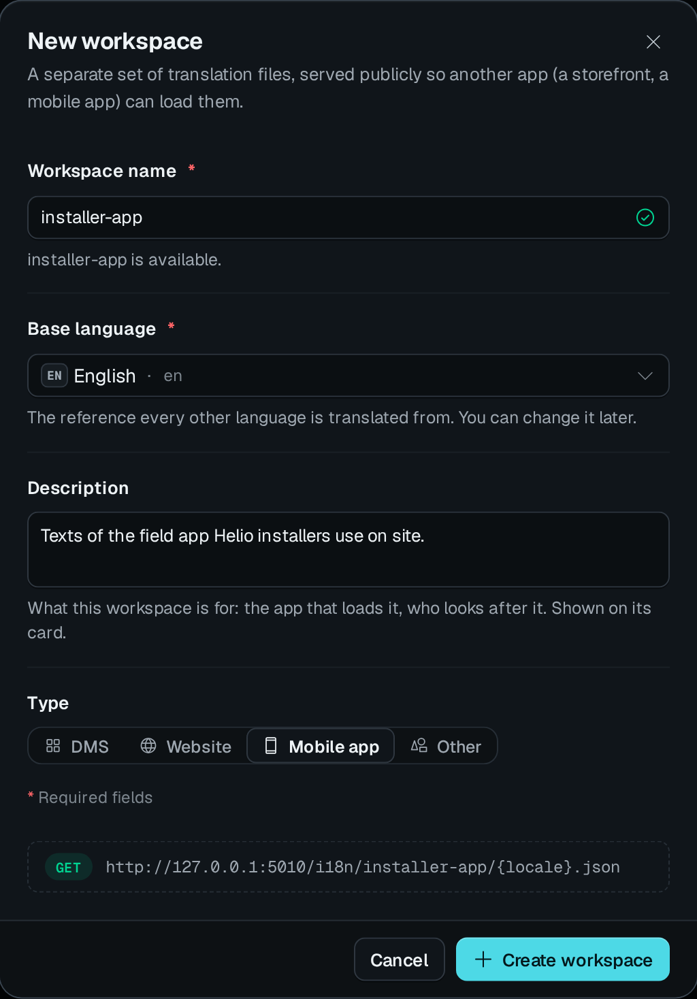

The Workspaces page lists every set of translation files with its size and coverage. It is under **Manage › Workspaces** in the navigation. The workspace you pick here is the one the Translate pages work on.

## The cards

Each card shows the workspace's **Languages**, **Keys** and **Coverage**, and a chip per language with its coverage. The fourth figure depends on the kind of workspace. A workspace you created shows **Missing**, the project files show **Overrides**, and the installed modules show **Overridden**.

- **Project files.** The locale files of the dashboard's own frontend module, any `<name>-<xx-XX>.json` file. Add a language by adding a file.
- **Workspaces you create.** Served publicly as JSON. The card shows the `GET` URL and a copy button.
- **Installed modules.** Read-only, and updated when a module is installed or upgraded.

**Switch** makes a workspace current and opens its overview. On the installed modules, the same button reads **Browse** and opens the translation matrix. On the current workspace, it reads **Open**. **Settings** opens the [workspace settings](/docs/modules/lang/usage/workspace-settings). From four workspaces on, a search field and a sort menu appear above the cards.

## Create a workspace

**New workspace** opens a dialog that asks for these fields:

- A name, made of lowercase letters, digits, `-` and `_`. It starts with a letter or a digit and has at most 64 characters. The names `default` and `modules` are reserved.
- A base language.
- An optional description.
- An optional type: **DMS**, **Website**, **Mobile app** or **Other**.

The dialog previews the public URL the workspace is served at.

## Import a workspace

**Import…** reads a JSON file and opens the **New workspace** dialog filled from it. The file can be one of these:

- A backup, such as the one **Download backup (.json)** produces in the danger zone of the workspace settings.
- A JSON object holding one object per language code.
- One language file named after its code, such as `it.json`.

A backup saved by a newer version of the module is refused, with a message to update the module.

::tip
The page follows the dashboard theme, light or dark.
::
