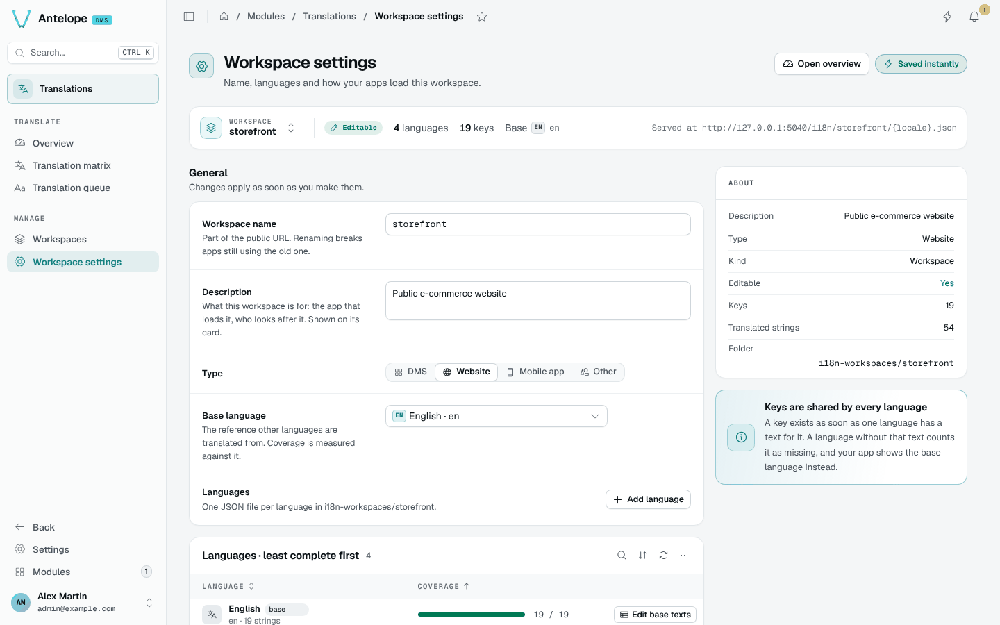

# Workspace settings

Workspace settings gather everything about one workspace. Open them from **Manage › Workspace settings** or from **Settings** on a workspace card. Changes save as soon as you make them.



## General

- **Workspace name**: part of the public URL. Renaming checks availability live and previews the URL before and after; apps still using the old URL break.
- **Description** and **Type**: shown on the workspace card.
- **Base language**: the reference other languages are translated from. Coverage is measured against it.
- **Languages**: one JSON file per language. **Add language** opens a searchable picker of native language names; any BCP 47 code typed in the search can be added.

## Use in your app

For a workspace you created, the **Use in your app** card gives the public URL and ready-to-paste snippets for **vue-i18n**, **i18next**, **fetch** and **curl**. The snippets load the base language, the language and the region variant, so `fr-BE` falls back to `fr`, then to the base.

```javascript [i18n.js]
const response = await fetch("https://api.example.com/i18n/storefront/fr.json");
if (!response.ok) throw new Error(`Locale request failed: ${response.status}`);
const messages = await response.json();
```

This short fetch reads French only. It does not implement the fallback chain;
use the generated vue-i18n or i18next setup when your app needs regional and
base-language fallback.

Messages use the vue-i18n format: `{name}` placeholders, plurals written `one | many`, and a literal `@` escaped as `{'@'}`.

## Danger zone

**Rename** and **Delete** list what they affect (files and translated strings) and ask you to type the workspace name. **Download backup** saves every language of the workspace as one JSON file you can [import](/docs/modules/lang/usage/workspaces#import-a-workspace) later.
