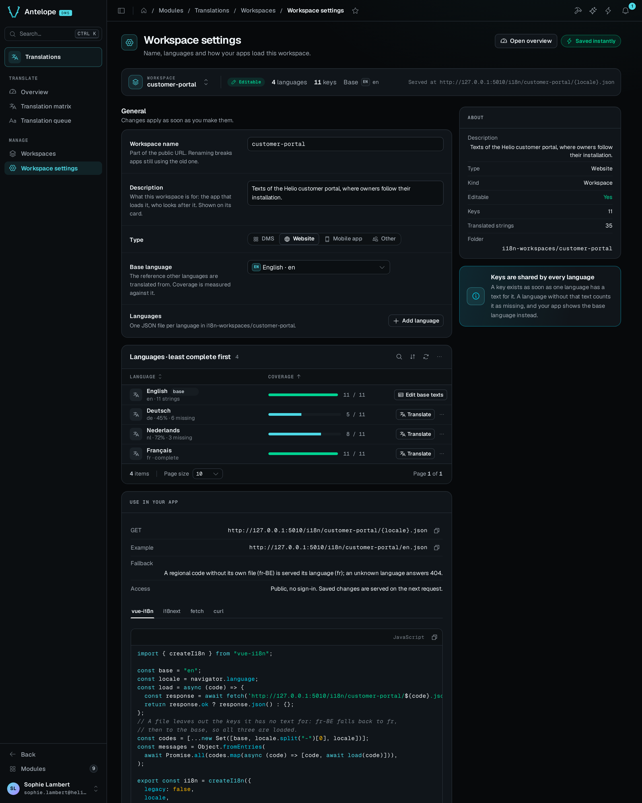

Workspace settings gather everything about one workspace. They are under **Manage › Workspace settings** in the navigation, and **Settings** on a workspace card opens them too. **Open overview** in the page header opens the workspace's overview.



## General

On a workspace you created, changes in this card save as soon as you make them.

- **Workspace name.** Part of the public URL. The field is read-only here. **Rename…** in the danger zone changes the name.
- **Description** and **Type.** Shown on the workspace card.
- **Base language.** The reference other languages are translated from. Coverage is measured against it.
- **Languages.** One JSON file per language, in `i18n-workspaces/<name>`. **Add language** opens a searchable picker of language names. You can also type any BCP 47 code, such as `pt-BR`, in its search field and add it.

On the project files and the installed modules, the card shows **Where the texts live** in place of the name, description and type.

Under the card, the **Languages** table lists each language with its coverage. Its row menu makes a language the base or removes it. The side column holds the **About** card (kind, editable, keys, translated strings and folder) and a note on how keys are shared between languages.

## Use in your app

For a workspace you created, the **Use in your app** card gives the public URL and ready-to-paste snippets for **vue-i18n**, **i18next**, **fetch** and **curl**. The vue-i18n and fetch snippets load the base language, the language and the region variant, so `fr-BE` falls back to `fr`, then to the base. The i18next snippet sets the base as its fallback language. The curl snippet requests the base language file.

```javascript [i18n.js]
const response = await fetch("https://api.example.com/i18n/storefront/fr.json");
if (!response.ok) throw new Error(`Locale request failed: ${response.status}`);
const messages = await response.json();
```

This short fetch reads French only and does not load the fallback languages. When your app needs the region and base-language fallback, use the generated vue-i18n, i18next or fetch snippet.

Messages use the vue-i18n format: `{name}` placeholders, plurals written `one | many`, and a literal `@` escaped as `{'@'}`.

## Danger zone

- **Backup.** **Download backup (.json)** saves every language file and the settings of the workspace as one JSON file. You can [import](/docs/modules/lang/usage/workspaces#import-a-workspace) it later.
- **Rename workspace.** **Rename…** asks for the new name, checks it as you type and shows the public URL before and after. Apps still calling the old URL get a 404 until you update them.
- **Delete workspace.** **Delete…** lists what it deletes (the language files, the translated strings, and the public URL that stops responding) and asks you to type the workspace name. The dialog also offers **Download backup (.json)**.
